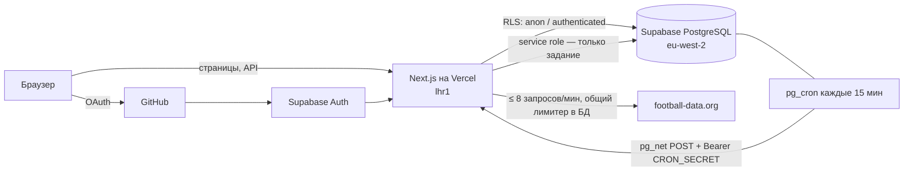

# Диванный аналитик

Учебный симулятор прогнозов на футбол: реальные матчи АПЛ, Бундеслиги и Ла Лиги, виртуальные монеты,
прогнозы на исход 1X2, автоматический расчет, статистика и рейтинг.

> **Дисклеймер.** Монеты не имеют денежной стоимости, их нельзя купить или вывести. Коэффициенты
> демонстрационные (детерминированная модель `demo-v1`), а не рыночные. Спортивные данные бесплатного тарифа
> football-data.org приходят с задержкой. Это не букмекерская контора и не реклама ставок.

**Живая версия:** https://divan-analytic.vercel.app — вход через GitHub.
Без входа доступны матчи и рейтинг; локальный demo-режим работает вообще без ключей.

Требования, архитектурные решения (ADR-001…060) и журнал прогресса — в [`CLAUDE.md`](./CLAUDE.md).

## Что внутри

- **Деньги — только в БД.** Прием прогноза — одна транзакция PostgreSQL (`place_bet`): проверка рынка, времени,
  свежести данных и версии котировки по часам БД, списание и запись в журнал. Баланс = сумма журнала —
  инвариант проверяется базой при фиксации транзакции; журнал только дописывается.
- **Повторы безопасны.** Идемпотентность по ключу (повтор с тем же ключом возвращает тот же прогноз), лимит
  частоты в БД, повторный расчет ничего не начисляет (уникальные ключи операций).
- **Расчет не угадывает.** Итог засчитывается после двух одинаковых наблюдений с интервалом ≥ 10 минут;
  неоднозначный итог не рассчитывается; изменение итога после расчета ставит матч на паузу для разбора.
- **Задание под арендой.** Синхронизация и расчет каждые 15 минут (Supabase Cron → Vercel); параллельный
  запуск пропускается, «зависший» исполнитель не может ничего записать (fencing по поколению аренды).
- **Права в базе, а не только в коде.** RLS на всех таблицах, клиентские роли не пишут ни в одну таблицу
  напрямую, админ-функции проверяют роль внутри SECURITY DEFINER. Проверено pgTAP-тестами прямыми вызовами.
- **Измерено.** p95, холодный старт и мобильный LCP — в [`docs/measurements.md`](./docs/measurements.md).

## Стек

Next.js 16 (App Router, `proxy.ts`), React 19, TypeScript strict, Tailwind CSS 4, Zod 4 · Supabase
(PostgreSQL 17, Auth через GitHub, RLS, pg_cron, pg_net, Vault) · Vercel (функции в `lhr1`, БД в `eu-west-2`) ·
football-data.org v4 · Vitest, Playwright (desktop + 360 px, axe), pgTAP · GitHub Actions.

## Архитектура



Конвейер задания: аренда → загрузка матчей → закрытие и создание рынков → подтверждение итогов → расчет пачки
→ очистка → освобождение аренды. Каждый шаг изолирован; итог OK/PARTIAL/SKIPPED/FAILED пишется в `job_runs`
и виден в `/admin`.

## Быстрый старт (demo, без ключей)

Нужны Node.js 22–24 и npm.

```bash
npm ci
npm run dev                  # http://localhost:3000 — вымышленные клубы, коэффициенты, рейтинг
npm run check                # формат, линтер, типы, unit-тесты
npm run build && npx playwright install chromium && npm run e2e
```

## Локально с базой (connected)

Нужен запущенный Docker Desktop. Supabase CLI ставится как devDependency.

```bash
npm run db:start             # локальный Supabase (первый раз — несколько минут)
npm run db:reset             # все миграции с нуля
npm run db:test              # pgTAP: ограничения, RLS, расчет, статистика, админка, hardening
npm run test:integration     # конкурентность: параллельные прогнозы и расчеты
```

`.env.local` по образцу `.env.example`: `APP_DATA_MODE=connected`, `APP_ORIGIN=http://localhost:3000`, ключи
локального Supabase (`npx supabase status`), `CRON_SECRET` (≥ 32 символов). Для реальных матчей —
`SPORTS_PROVIDER=football-data` и бесплатный токен football-data.org. Вход через GitHub локально требует
своего OAuth App с callback `http://127.0.0.1:54321/auth/v1/callback`.

Полная проверка на Windows одной командой (сбрасывает локальную БД, пишет отчет в `.verify/report.txt`):

```powershell
powershell -ExecutionPolicy Bypass -File scripts\verify.ps1            # + -Measure для замеров
```

## Режимы окружения

| Переменная        | Значения                     | По умолчанию |
| ----------------- | ---------------------------- | ------------ |
| `APP_DATA_MODE`   | `demo` / `connected`         | `demo`       |
| `SPORTS_PROVIDER` | `fixtures` / `football-data` | `fixtures`   |

- `demo` не требует ключей и допускает только `fixtures`; прогнозы не принимаются, данные вымышленные.
- `connected` требует Supabase, `APP_ORIGIN`, `SUPABASE_SERVICE_ROLE_KEY` и `CRON_SECRET`.
- Противоречивые комбинации и секреты с префиксом `NEXT_PUBLIC_` отклоняются при старте.
- На Vercel connected-переменные заданы только для Production; Preview-сборки остаются demo.

## Тесты и CI

| Уровень           | Что проверяет                                                                                           |
| ----------------- | ------------------------------------------------------------------------------------------------------- |
| Unit (Vitest)     | коэффициенты, правила приема, формулы статистики, CSP, очистка логов, парсинг поставщика                |
| pgTAP (10 файлов) | ограничения и инварианты, RLS и прямые RPC, прием, расчет, статистика против прямого SQL, права админки |
| Интеграция        | 20 параллельных прогнозов при балансе 1000 → ровно 6; 10 параллельных расчетов → одна выплата           |
| E2E (Playwright)  | каталог, страница матча, рейтинг, вход в demo, CSP без нарушений, axe WCAG 2.1 A/AA, 360 px             |

GitHub Actions на каждый push: формат, линтер, типы, unit, build, e2e; отдельно — миграции с нуля, pgTAP и
интеграция на локальном Supabase; `npm audit` (информационно).

## Деплой и эксплуатация

- Выпуск в production по шагам: [`docs/deploy.md`](./docs/deploy.md). Миграции применяются вручную
  (`npx supabase db push --linked`), не из сборки Vercel.
- Сбои, компенсации, резервная копия и восстановление: [`docs/runbook.md`](./docs/runbook.md).
- Сценарий показа проекта: [`docs/demo-script.md`](./docs/demo-script.md).
- Вход работает только с основного домена `divan-analytic.vercel.app`: служебные адреса деплоев отвечают
  403 — Origin запроса должен совпадать с `APP_ORIGIN`.

## Компромиссы

- **Без отдельного backend.** Транзакции и инварианты — в PostgreSQL-функциях; Next.js — тонкий слой
  валидации и UI. Меньше движущихся частей на бесплатной инфраструктуре, но логика расчета написана на SQL.
- **Задержка вместо live.** Бесплатный поставщик не дает live-данных; прием закрывается за 5 минут до начала
  и при данных старше часа, а итог подтверждается повторным наблюдением.
- **Кеш в памяти функции** для рейтинга (60 с) вместо внешнего кеша — согласованность между экземплярами не нужна.
- **CSP с nonce** делает все страницы динамическими: статической отрисовки нет, зато нет `unsafe-inline` для скриптов.
- **Компенсации — только SQL владельца** по runbook, без кнопок в вебе.

## Ограничения

- football-data.org Free: 10 запросов в минуту, 12 соревнований, данные с задержкой; используются 3 лиги.
- Supabase Free: проект засыпает после недели без запросов (задание каждые 15 минут это предотвращает),
  нет платного PITR — резервная копия делается вручную (runbook).
- Vercel Hobby: функции до 60 с, один регион.
- Проверенный масштаб — профиль из 50 пользователей, 2 000 матчей и 10 000 прогнозов (локально).
  Облачные замеры — в `docs/measurements.md`. Это учебный проект, а не «production ready» сервис.
