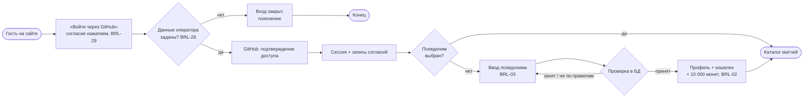
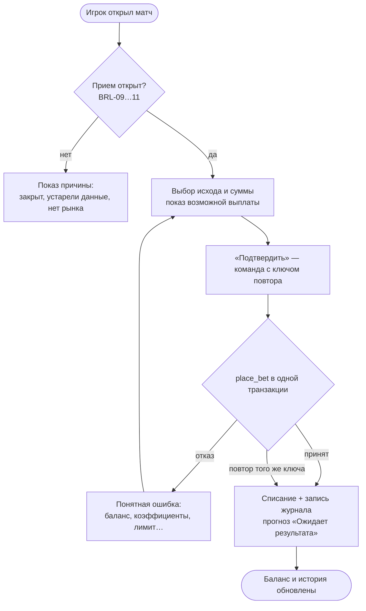
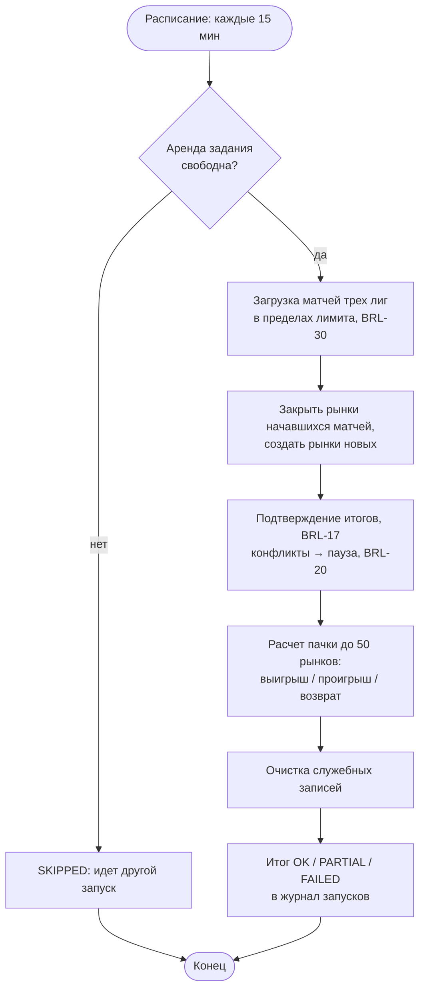

# 02. Бизнес-требования, бизнес-правила и процессы

## 1. Бизнес-требования

| ID    | Требование                                                                                         | Источник  | Приоритет | Цели   |
| ----- | -------------------------------------------------------------------------------------------------- | --------- | --------- | ------ |
| BR-01 | Игрок делает прогнозы на исход реальных матчей без денежного риска и видит, угадал ли              | владелец  | Must      | G3     |
| BR-02 | Учет монет точен и проверяем по журналу при любых сбоях, повторах и параллельных запросах          | владелец  | Must      | G1, G2 |
| BR-03 | Итоги подтверждаются и прогнозы рассчитываются автоматически; спорные итоги не угадываются         | владелец  | Must      | G3     |
| BR-04 | Игроки соревнуются в публичном рейтинге, не раскрывая личность и данные GitHub                     | владелец  | Must      | G7     |
| BR-05 | Администратор видит состояние синхронизации и причину задержки каждого расчета, может вмешаться    | владелец  | Should    | G3     |
| BR-06 | Персональные данные обрабатываются с указанием оператора, согласиями и правом на удаление (152-ФЗ) | закон     | Must      | G7     |
| BR-07 | Продукт работает на бесплатной инфраструктуре и в пределах лимитов поставщика данных               | бюджет    | Must      | —      |
| BR-08 | Продукт можно посмотреть и запустить без ключей; ревьюер видит качество решений                    | портфолио | Must      | G6     |

## 2. Каталог бизнес-правил

Правила — источник истины для требований SRS и тестов. «Где обеспечено» указывает слой, который гарантирует
правило: если правило держится в БД, его нельзя обойти прямым вызовом API.

| ID     | Правило                                                                                                                                                                                                                                                                                                     | Где обеспечено                                                 |
| ------ | ----------------------------------------------------------------------------------------------------------------------------------------------------------------------------------------------------------------------------------------------------------------------------------------------------------- | -------------------------------------------------------------- |
| BRL-01 | Монеты виртуальные: без денежной стоимости, их нельзя купить, продать или вывести. Призов нет                                                                                                                                                                                                               | продукт, тексты                                                |
| BRL-02 | Стартовый кредит — 10 000 монет, один раз, в момент выбора псевдонима                                                                                                                                                                                                                                       | БД (`set_pseudonym`, уникальный индекс на `INITIAL_CREDIT`)    |
| BRL-03 | Псевдоним: 3–24 символа; русские и латинские буквы, цифры, пробел, `.`, `_`, `-`; начинается с буквы или цифры; пробелы нормализуются; не совпадает (без учета регистра) с логином, именем или частью почты до `@` из GitHub; не зарезервирован; уникален без учета регистра; не больше 10 попыток в минуту | БД (`set_pseudonym`, индекс), зеркало в `src/lib/pseudonym.ts` |
| BRL-04 | Псевдоним выбирается один раз и не меняется; сбросить может только оператор                                                                                                                                                                                                                                 | БД (`ALREADY_SET`, нет прав на UPDATE)                         |
| BRL-05 | Без псевдонима нет профиля, кошелька, прогнозов и места в рейтинге                                                                                                                                                                                                                                          | БД (`place_bet` → `PSEUDONYM_REQUIRED`)                        |
| BRL-06 | Прогноз — один исход основного времени: победа хозяев (1), ничья (X), победа гостей (2)                                                                                                                                                                                                                     | БД, контракт API                                               |
| BRL-07 | Сумма прогноза — целое число от 10 до 1 000 монет и не больше баланса                                                                                                                                                                                                                                       | БД (CHECK, `INSUFFICIENT_BALANCE`)                             |
| BRL-08 | На один матч — один прогноз; принятый прогноз не отменяется и не изменяется                                                                                                                                                                                                                                 | БД (уникальность, триггер неизменяемости)                      |
| BRL-09 | Прием закрывается за 5 минут до начала матча; время — по часам БД, не браузера                                                                                                                                                                                                                              | БД (`place_bet`)                                               |
| BRL-10 | Если данные матча старше 60 минут, прием временно закрыт                                                                                                                                                                                                                                                    | БД (`DATA_STALE`)                                              |
| BRL-11 | Прием возможен только на открытый рынок запланированного матча                                                                                                                                                                                                                                              | БД (`MARKET_CLOSED`)                                           |
| BRL-12 | Если коэффициенты изменились после показа, прогноз не принимается, игрок видит новые                                                                                                                                                                                                                        | БД (`quote_version`, `QUOTE_CHANGED`)                          |
| BRL-13 | Возможная выплата = ⌊сумма × коэффициент / 1000⌋ в «милли»-единицах и включает сумму прогноза; коэффициент фиксируется в момент приема                                                                                                                                                                      | БД (CHECK формулы)                                             |
| BRL-14 | Повтор команды с тем же ключом и теми же данными возвращает исходный результат без второго списания; с другими данными — отказ                                                                                                                                                                              | БД (`idempotency_key`, `request_hash`)                         |
| BRL-15 | Не больше 10 попыток прогноза в минуту на игрока                                                                                                                                                                                                                                                            | БД (`rate_limit_hit`)                                          |
| BRL-16 | Коэффициенты демонстрационные: детерминированная модель `demo-v1`, маржа 1,06, диапазон 1,10–12,00                                                                                                                                                                                                          | домен (`demo-odds.ts`), CHECK в БД                             |
| BRL-17 | Итог засчитывается, когда поставщик дважды сообщил один и тот же результат с интервалом не меньше 10 минут                                                                                                                                                                                                  | БД (`sync_confirm_results`)                                    |
| BRL-18 | Учитывается только основное время. Технический результат и неполный счет — неоднозначный итог, автоматически не рассчитывается                                                                                                                                                                              | разбор поставщика, БД                                          |
| BRL-19 | Подтвержденная отмена или перенос — возврат суммы. Прерванный матч без итога через 48 ч от начала — возврат                                                                                                                                                                                                 | БД (`settle_market`)                                           |
| BRL-20 | Изменение итога после расчета: автоматика по матчу на паузе, запись в аудит, ручной разбор; начисленное автоматически не списывается; компенсация — только новой записью журнала и без ухода в минус                                                                                                        | БД (`sync_confirm_results`, `admin_compensate`)                |
| BRL-21 | Баланс равен сумме журнала операций и не бывает отрицательным; журнал только дописывается                                                                                                                                                                                                                   | БД (отложенный триггер, CHECK, триггер append-only)            |
| BRL-22 | Статистика учитывает только выигрыши и проигрыши. Win rate = выигрыши / (выигрыши + проигрыши); ROI = (выплаты − ставки) / ставки; при нуле в знаменателе — «—». Возвраты и ожидающие показываются отдельно                                                                                                 | домен (`stats.ts`), БД (`my_stats`)                            |
| BRL-23 | Рейтинг: игроки с псевдонимом, не отключенные, с 5+ рассчитанными прогнозами; порядок — чистый результат ↓, число рассчитанных ↓, затем стабильный технический ключ; не по балансу. Обновление — не реже раза в минуту                                                                                      | БД (`leaderboard_ranked`), кеш 60 с                            |
| BRL-24 | В публичные ответы не попадают идентификаторы, почта, логин и аватар GitHub, баланс                                                                                                                                                                                                                         | БД (безопасный DTO), pgTAP                                     |
| BRL-25 | Ручной запуск синхронизации — не чаще раза в 5 минут на всех администраторов                                                                                                                                                                                                                                | БД (`admin_request_sync`)                                      |
| BRL-26 | Роль администратора берется только из таблицы ролей; отключенный профиль теряет права                                                                                                                                                                                                                       | БД (`is_admin`)                                                |
| BRL-27 | Удаление аккаунта: подтверждение псевдонимом (или словом «удалить», если его нет); профиль обезличивается, вход закрывается, журнал денег и прогнозы остаются без имени; повторный вход создает новый аккаунт                                                                                               | БД (`delete_my_account`), Supabase Auth                        |
| BRL-28 | Вход закрыт, пока не указаны ФИО и почта оператора персональных данных                                                                                                                                                                                                                                      | приложение (`/auth/login`)                                     |
| BRL-29 | Нажатие «Войти» — согласие с Пользовательским соглашением (18+) и на обработку ПДн текущей версии; согласия записываются в журнал, который только дописывается                                                                                                                                              | приложение, БД (`record_consents`)                             |
| BRL-30 | К поставщику — не больше 8 запросов в минуту; ответ 429 ставит паузу до указанного времени                                                                                                                                                                                                                  | БД (`provider_try_acquire`)                                    |

## 3. Процессы TO-BE

### P1. Онбординг игрока

### P2. Прогноз

### P3. От синхронизации до расчета (каждые 15 минут)

### P4. Разбор спорного итога (администратор)

