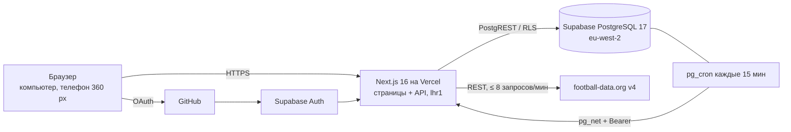

# 03. Спецификация требований к ПО (SRS)

Структура по ISO/IEC/IEEE 29148: назначение, общее описание, функциональные и нефункциональные требования,
ограничения и интерфейсы. Формулировка требований — «Система должна…»; каждое проверяемо и прослеживается
до правил ([02](./02-business-requirements.md)), сценариев ([04](./04-use-cases.md)) и тестов
([11](./11-traceability.md)).

## 1. Назначение и область

Система «Диванный аналитик» — веб-приложение для прогнозов на исход футбольных матчей на виртуальные монеты.
Документ задает требования к версии MVP (релиз 1.0). Не рассматриваются реальные деньги, live-ставки и
мобильные приложения (см. [01-vision.md](./01-vision.md#6-границы)).

## 2. Общее описание

### 2.1. Окружение

### 2.2. Режимы работы

| Режим       | Назначение                            | Данные                                        | Вход и прогнозы |
| ----------- | ------------------------------------- | --------------------------------------------- | --------------- |
| `demo`      | показ без ключей, preview-сборки, e2e | вымышленные клубы, фиксированное «сейчас»     | нет             |
| `connected` | рабочий сайт, локальная разработка    | БД + поставщик `football-data` или `fixtures` | да              |

### 2.3. Классы пользователей

Гость; вошедший без псевдонима; игрок; администратор; системные исполнители — расписание и задание.
Права — [09-roles-and-access.md](./09-roles-and-access.md).

## 3. Функциональные требования

Статус: ✅ реализовано и покрыто автотестами; ◐ реализовано, проверка ручная; ○ план.

### 3.1. Вход и согласия (AUTH)

| ID         | Система должна                                                                                              | Пр.  | Правила | Статус |
| ---------- | ----------------------------------------------------------------------------------------------------------- | ---- | ------- | ------ |
| FR-AUTH-01 | обеспечивать вход только через GitHub OAuth (почта и пароль отключены)                                      | Must | —       | ◐      |
| FR-AUTH-02 | запускать вход только POST-запросом с собственного домена (проверка Origin)                                 | Must | —       | ✅     |
| FR-AUTH-03 | закрывать вход, пока не заданы ФИО и почта оператора ПДн, и объяснять причину                               | Must | BRL-28  | ✅     |
| FR-AUTH-04 | показывать под кнопкой входа ссылки на Соглашение, Согласие на обработку ПДн и Политику; нажатие = согласие | Must | BRL-29  | ✅     |
| FR-AUTH-05 | после возврата из GitHub записывать согласия с версией документов; без отметки согласия сессию не создавать | Must | BRL-29  | ✅     |
| FR-AUTH-06 | возвращать пользователя на исходную страницу только по безопасному внутреннему адресу (без open redirect)   | Must | —       | ✅     |
| FR-AUTH-07 | направлять вошедшего без псевдонима на страницу выбора псевдонима                                           | Must | BRL-05  | ✅     |
| FR-AUTH-08 | обновлять сессию на каждом запросе и проверять пользователя на сервере в каждом приватном маршруте          | Must | —       | ✅     |
| FR-AUTH-09 | обеспечивать выход с удалением cookie сессии                                                                | Must | —       | ◐      |

### 3.2. Псевдоним и профиль (PSN)

| ID        | Система должна                                                                                                                            | Пр.    | Правила | Статус |
| --------- | ----------------------------------------------------------------------------------------------------------------------------------------- | ------ | ------- | ------ |
| FR-PSN-01 | давать вошедшему выбрать псевдоним по правилам и показывать правила рядом с полем                                                         | Must   | BRL-03  | ✅     |
| FR-PSN-02 | проверять псевдоним в БД; при нарушении возвращать конкретную причину (занят, не по правилам, совпадает с данными GitHub, зарезервирован) | Must   | BRL-03  | ✅     |
| FR-PSN-03 | при выборе псевдонима атомарно создавать профиль, кошелек и начислять 10 000 монет                                                        | Must   | BRL-02  | ✅     |
| FR-PSN-04 | не позволять менять псевдоним; повтор того же имени считать успехом без изменений                                                         | Must   | BRL-04  | ✅     |
| FR-PSN-05 | ограничивать попытки выбора 10 в минуту                                                                                                   | Should | BRL-03  | ✅     |
| FR-PSN-06 | не хранить и не показывать аватар и логин GitHub в профиле                                                                                | Must   | BRL-24  | ✅     |

### 3.3. Каталог матчей (CAT)

| ID        | Система должна                                                                                             | Пр.  | Правила   | Статус |
| --------- | ---------------------------------------------------------------------------------------------------------- | ---- | --------- | ------ |
| FR-CAT-01 | показывать матчи трех лиг с фильтрами: соревнование, «Предстоящие / Завершенные / Все», дата, часовой пояс | Must | —         | ✅     |
| FR-CAT-02 | по умолчанию показывать предстоящие матчи, начиная с ближайших                                             | Must | —         | ✅     |
| FR-CAT-03 | показывать время в часовом поясе браузера и явно подписывать зону                                          | Must | —         | ✅     |
| FR-CAT-04 | показывать на карточке коэффициенты 1/X/2, статус, счет основного времени и состояние приема с причиной    | Must | BRL-09…11 | ✅     |
| FR-CAT-05 | предупреждать об устаревших данных матча (старше 60 минут)                                                 | Must | BRL-10    | ✅     |
| FR-CAT-06 | постранично выдавать каталог стабильным курсором (по 20, до 100)                                           | Must | —         | ✅     |
| FR-CAT-07 | отвечать 404 на несуществующий матч                                                                        | Must | —         | ✅     |

### 3.4. Прогнозы (BET)

| ID        | Система должна                                                                                                                                           | Пр.    | Правила           | Статус |
| --------- | -------------------------------------------------------------------------------------------------------------------------------------------------------- | ------ | ----------------- | ------ |
| FR-BET-01 | давать игроку выбрать исход и сумму и показывать возможную выплату до подтверждения                                                                      | Must   | BRL-06, 07, 13    | ✅     |
| FR-BET-02 | принимать прогноз одной транзакцией БД: проверки, фиксация коэффициента, списание, запись журнала                                                        | Must   | BRL-07…13, 21     | ✅     |
| FR-BET-03 | отклонять прогноз с понятной причиной: закрыт прием, устарели данные, изменились коэффициенты, не хватает монет, уже есть прогноз, лимит, нет псевдонима | Must   | BRL-05, 07…12, 15 | ✅     |
| FR-BET-04 | обрабатывать повтор команды с тем же ключом без второго списания                                                                                         | Must   | BRL-14            | ✅     |
| FR-BET-05 | не принимать от клиента коэффициент, выплату и идентификатор пользователя (лишние поля — ошибка)                                                         | Must   | —                 | ✅     |
| FR-BET-06 | показывать сделанный прогноз на странице матча вместо купона                                                                                             | Should | BRL-08            | ✅     |
| FR-BET-07 | показывать историю прогнозов со статусами текстом (не только цветом), фильтром по статусу и постраничностью                                              | Must   | —                 | ✅     |

### 3.5. Кошелек (WAL)

| ID        | Система должна                                                               | Пр.    | Правила | Статус |
| --------- | ---------------------------------------------------------------------------- | ------ | ------- | ------ |
| FR-WAL-01 | показывать баланс и журнал операций со знаком суммы и видом операции         | Must   | BRL-21  | ✅     |
| FR-WAL-02 | гарантировать «баланс = сумма журнала» и неотрицательный баланс на уровне БД | Must   | BRL-21  | ✅     |
| FR-WAL-03 | запрещать изменение и удаление записей журнала                               | Must   | BRL-21  | ✅     |
| FR-WAL-04 | не показывать баланс при ошибке чтения (чтобы не ввести в заблуждение)       | Should | —       | ◐      |

### 3.6. Синхронизация и расчет (SYNC, SET)

| ID         | Система должна                                                                                    | Пр.    | Правила    | Статус |
| ---------- | ------------------------------------------------------------------------------------------------- | ------ | ---------- | ------ |
| FR-SYNC-01 | загружать матчи PL, BL1, PD в окне дат вокруг текущего дня каждые 15 минут                        | Must   | BRL-30     | ◐      |
| FR-SYNC-02 | не превышать 8 запросов в минуту к поставщику и соблюдать паузу после 429                         | Must   | BRL-30     | ✅     |
| FR-SYNC-03 | не создавать дубликатов и не перезаписывать более новые данные более старыми                      | Must   | —          | ✅     |
| FR-SYNC-04 | при сбое поставщика сохранять ранее загруженные данные и помечать запуск PARTIAL                  | Must   | —          | ✅     |
| FR-SYNC-05 | закрывать рынки начавшихся матчей и создавать рынки с детерминированными коэффициентами для новых | Must   | BRL-16     | ✅     |
| FR-SYNC-06 | выполнять только один запуск одновременно (аренда с поколением); устаревший исполнитель не пишет  | Must   | —          | ✅     |
| FR-SYNC-07 | принимать запуск только с секретом расписания или от администратора                               | Must   | BRL-25     | ✅     |
| FR-SET-01  | подтверждать итог вторым одинаковым наблюдением через ≥ 10 минут                                  | Must   | BRL-17     | ✅     |
| FR-SET-02  | рассчитывать WON / LOST по основному времени, VOID — при отмене, переносе, прерывании > 48 ч      | Must   | BRL-18, 19 | ✅     |
| FR-SET-03  | не рассчитывать неоднозначный итог                                                                | Must   | BRL-18     | ✅     |
| FR-SET-04  | рассчитывать повторно без повторных начислений                                                    | Must   | BRL-14, 21 | ✅     |
| FR-SET-05  | при изменении итога после расчета ставить матч на паузу и писать аудит                            | Must   | BRL-20     | ✅     |
| FR-SET-06  | изолировать сбой расчета одного рынка (аудит) и продолжать остальные                              | Should | —          | ✅     |

### 3.7. Статистика и рейтинг (STAT, LB)

| ID         | Система должна                                                                                                         | Пр.    | Правила | Статус |
| ---------- | ---------------------------------------------------------------------------------------------------------------------- | ------ | ------- | ------ |
| FR-STAT-01 | показывать игроку: рассчитано, выигрыши, проигрыши, win rate, сумму ставок, чистый результат, ROI, возвраты, ожидающие | Must   | BRL-22  | ✅     |
| FR-STAT-02 | показывать «—» при нулевом знаменателе и объяснять формулы на странице                                                 | Must   | BRL-22  | ✅     |
| FR-STAT-03 | показывать место в рейтинге или сколько прогнозов осталось до допуска                                                  | Should | BRL-23  | ✅     |
| FR-LB-01   | показывать публичный рейтинг по правилам допуска и сортировки                                                          | Must   | BRL-23  | ✅     |
| FR-LB-02   | публиковать в рейтинге только место, псевдоним и итоговые числа                                                        | Must   | BRL-24  | ✅     |
| FR-LB-03   | обновлять рейтинг не реже раза в минуту                                                                                | Should | BRL-23  | ✅     |

### 3.8. Аккаунт (ACC)

| ID        | Система должна                                                                                  | Пр.    | Правила    | Статус |
| --------- | ----------------------------------------------------------------------------------------------- | ------ | ---------- | ------ |
| FR-ACC-01 | давать пользователю удалить аккаунт с подтверждением псевдонимом                                | Must   | BRL-27     | ✅     |
| FR-ACC-02 | при удалении обезличивать профиль, снимать роли, закрывать вход, завершать сессию, писать аудит | Must   | BRL-27     | ✅     |
| FR-ACC-03 | сохранять журнал денег и прогнозы удаленного аккаунта без связи с именем                        | Must   | BRL-21, 27 | ✅     |
| FR-ACC-04 | показывать на странице аккаунта псевдоним, согласия и последствия удаления                      | Should | —          | ◐      |

### 3.9. Администрирование (ADM)

| ID        | Система должна                                                                                                                                                   | Пр.    | Правила   | Статус |
| --------- | ---------------------------------------------------------------------------------------------------------------------------------------------------------------- | ------ | --------- | ------ |
| FR-ADM-01 | показывать администратору: последний успех и ошибку задания, аренду, последние запуски, запросы к поставщику за сутки, устаревшие матчи, конфликты, сбои расчета | Should | —         | ✅     |
| FR-ADM-02 | показывать очередь нерассчитанных рынков с причиной ожидания и ожидаемым временем                                                                                | Should | BRL-17…20 | ✅     |
| FR-ADM-03 | давать запустить синхронизацию вручную не чаще раза в 5 минут                                                                                                    | Should | BRL-25    | ✅     |
| FR-ADM-04 | давать снять паузу конфликта с указанием причины; записывать автора в аудит                                                                                      | Should | BRL-20    | ✅     |
| FR-ADM-05 | скрывать админку (404) и отказывать в API (403) всем, кроме администратора                                                                                       | Must   | BRL-26    | ✅     |

### 3.10. Документы, интерфейс, demo (LEG, UI, DEMO)

| ID         | Система должна                                                                           | Пр.   | Правила    | Статус |
| ---------- | ---------------------------------------------------------------------------------------- | ----- | ---------- | ------ |
| FR-LEG-01  | публиковать Пользовательское соглашение, Политику обработки ПДн, Согласие, Правила       | Must  | BRL-28, 29 | ✅     |
| FR-LEG-02  | показывать в подвале ссылки на документы, отметку 18+, дисклеймер и атрибуцию источников | Must  | BRL-01     | ✅     |
| FR-UI-01   | поддерживать тему «День/Ночь» с сохранением выбора; без выбора — системная               | Could | —          | ✅     |
| FR-UI-02   | показывать декоративный фон с параллаксом, неподвижный при «уменьшить движение»          | Could | —          | ✅     |
| FR-DEMO-01 | работать в режиме demo без ключей на вымышленных данных и с явной пометкой               | Must  | —          | ✅     |
| FR-DEMO-02 | не принимать прогнозы и не открывать личные разделы в demo                               | Must  | —          | ✅     |

## 4. Нефункциональные требования

| ID     | Категория            | Требование                                                                                                                | Проверка                                          | Статус                |
| ------ | -------------------- | ------------------------------------------------------------------------------------------------------------------------- | ------------------------------------------------- | --------------------- |
| NFR-01 | Производительность   | p95: список матчей ≤ 800 мс, история ≤ 1000 мс, прием прогноза ≤ 1500 мс (прогретое приложение, профиль NFR-02)           | `measure.mjs`, `measure-cloud.mjs`                | ✅ локально, облако ◐ |
| NFR-02 | Нагрузка             | профиль: 50 активных пользователей, 2 000 матчей, 10 000 прогнозов                                                        | `measure.mjs`                                     | ✅                    |
| NFR-03 | Мобильность          | LCP ≤ 2,5 с (Pixel 5, CPU ×4, медленный 4G); ширина от 360 px без горизонтальной прокрутки                                | `measure.mjs`, e2e mobile-360                     | ✅                    |
| NFR-04 | Отзывчивость         | реакция интерфейса на действие ≤ 100 мс                                                                                   | `measure-cloud.mjs` (Event Timing)                | ○                     |
| NFR-05 | Надежность денег     | «баланс = журнал», журнал append-only, неизменяемость прогноза — ограничениями БД                                         | pgTAP 01, 03, 07, 11                              | ✅                    |
| NFR-06 | Конкурентность       | параллельные прием и расчет не дают двойных списаний и выплат                                                             | интеграционные тесты                              | ✅                    |
| NFR-07 | Доступность          | WCAG 2.1 A/AA: клавиатура, видимый фокус, подписи, ошибки связаны с полями, статусы не только цветом                      | axe в e2e, ручная проверка                        | ✅                    |
| NFR-08 | Безопасность доступа | RLS на всех таблицах; клиентские роли не пишут в таблицы напрямую; SECURITY DEFINER только с фиксированным `search_path`  | pgTAP 02, 10                                      | ✅                    |
| NFR-09 | Безопасность HTTP    | Origin для изменяющих запросов; CSP с nonce, `frame-ancestors 'none'`; ограничение тела; нет permissive CORS              | unit routes-http, e2e security                    | ✅                    |
| NFR-10 | Секреты              | секреты только на сервере; `NEXT_PUBLIC_*` с секретами отклоняются при старте; логи очищаются от токенов, cookie, почты   | unit env, log-redaction; verify «secrets in logs» | ✅                    |
| NFR-11 | Приватность          | публичные ответы без идентификаторов, почты, данных GitHub; приватные ответы `no-store`                                   | pgTAP 08, unit routes-http                        | ✅                    |
| NFR-12 | Наблюдаемость        | структурированные события (requestId, длительность, статус задания); журнал запусков; аудит                               | `/admin`, `job_runs`, `audit_events`              | ✅                    |
| NFR-13 | Доступность сервиса  | расписание каждые 15 мин; сбой поставщика не роняет сайт; при недоступности БД — понятные ошибки 503                      | e2e, runbook                                      | ◐                     |
| NFR-14 | Восстановимость      | ручная резервная копия и проверенное локально восстановление; откат деплоя не откатывает БД — миграции только расширяющие | runbook, deploy                                   | ◐                     |
| NFR-15 | Сопровождаемость     | TypeScript strict, линтер, форматирование, CI на каждый push; решения — ADR                                               | GitHub Actions                                    | ✅                    |
| NFR-16 | Воспроизводимость    | demo запускается за ≤ 5 минут без ключей; полная локальная проверка — одной командой                                      | README, `verify.ps1`                              | ✅                    |
| NFR-17 | Совместимость        | актуальные Chrome, Firefox, Safari, Edge; телефоны от 360 px                                                              | e2e (Chromium desktop и Pixel 5)                  | ◐                     |
| NFR-18 | Локализация          | интерфейс на русском; время — в зоне браузера с явной подписью; числа в формате ru-RU                                     | e2e                                               | ✅                    |

## 5. Ограничения проектирования

- Next.js 16 App Router, React 19, TypeScript strict, Tailwind 4, Zod 4; Supabase (PostgreSQL 17, Auth, pg_cron,
  pg_net, Vault); Vercel Hobby; football-data.org Free.
- Денежная логика и права — в функциях PostgreSQL; клиент никогда не присылает коэффициент, выплату или
  идентификатор пользователя.
- Миграции применяются вручную до выпуска кода; примененные миграции не изменяются.
- Тарифные лимиты: функция Vercel ≤ 60 с; поставщик ≤ 10 запросов/мин (внутренний бюджет — 8).

## 6. Внешние интерфейсы

- Пользовательский — [10-ui-screens.md](./10-ui-screens.md).
- Программный — [docs/api.md](../api.md), [openapi.yaml](./openapi.yaml).
- Внешние системы — [08-integrations.md](./08-integrations.md).
