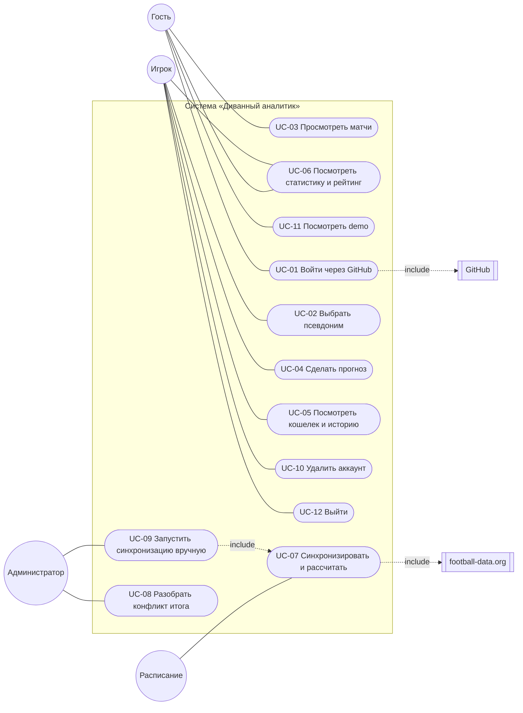

# 04. Варианты использования

## 1. Диаграмма

Администратор — это игрок с ролью `ADMIN`: ему доступны и все сценарии игрока.

## 2. Сводка

| ID    | Название                        | Основной актор          | Приоритет | Требования                  |
| ----- | ------------------------------- | ----------------------- | --------- | --------------------------- |
| UC-01 | Войти через GitHub              | Гость                   | Must      | FR-AUTH-01…08               |
| UC-02 | Выбрать псевдоним               | Вошедший без псевдонима | Must      | FR-PSN-01…06                |
| UC-03 | Просмотреть матчи               | Гость, игрок            | Must      | FR-CAT-01…07                |
| UC-04 | Сделать прогноз                 | Игрок                   | Must      | FR-BET-01…06                |
| UC-05 | Посмотреть кошелек и историю    | Игрок                   | Must      | FR-WAL-01…04, FR-BET-07     |
| UC-06 | Посмотреть статистику и рейтинг | Игрок, гость (рейтинг)  | Must      | FR-STAT-01…03, FR-LB-01…03  |
| UC-07 | Синхронизировать и рассчитать   | Расписание              | Must      | FR-SYNC-01…07, FR-SET-01…06 |
| UC-08 | Разобрать конфликт итога        | Администратор           | Should    | FR-ADM-02, 04               |
| UC-09 | Запустить синхронизацию вручную | Администратор           | Should    | FR-ADM-01, 03               |
| UC-10 | Удалить аккаунт                 | Игрок                   | Must      | FR-ACC-01…03                |
| UC-11 | Посмотреть demo                 | Гость                   | Must      | FR-DEMO-01, 02              |
| UC-12 | Выйти                           | Игрок                   | Must      | FR-AUTH-09                  |

## 3. Описания

### UC-01. Войти через GitHub

- **Актор:** гость. **Цель:** получить сессию.
- **Предусловия:** режим `connected`; заданы данные оператора ПДн.
- **Основной поток:**
  1. Гость нажимает «Войти через GitHub»; под кнопкой — ссылки на документы и пояснение, что нажатие означает согласие и подтверждение 18+.
  2. Система проверяет Origin, запоминает адрес возврата и версию документов в короткоживущих cookie и перенаправляет на GitHub через Supabase Auth.
  3. Гость подтверждает доступ на GitHub.
  4. Система обменивает код на сессию и записывает согласия.
  5. Если псевдоним не выбран — переход к UC-02; иначе — на исходную страницу.
- **Альтернативы:**
  - 1a. Данные оператора не заданы → кнопка недоступна, показывается причина (BRL-28).
  - 3a. Гость отказался на GitHub → страница входа с сообщением «вход отменен».
  - 4a. Нет cookie согласия (обход формы) → сессия не создается, сообщение «нужно согласие».
  - 4b. Аккаунт отключен → выход и сообщение «аккаунт отключен».
- **Постусловия:** сессия в cookie; в журнале согласий две записи с версией документов.
- **Правила:** BRL-28, BRL-29.

### UC-02. Выбрать псевдоним

- **Актор:** вошедший без псевдонима. **Цель:** стать игроком.
- **Предусловия:** есть сессия; профиля нет.
- **Основной поток:**
  1. Система показывает правила псевдонима и предупреждение, что он выбирается один раз и не должен раскрывать личность.
  2. Пользователь вводит имя и нажимает «Выбрать псевдоним».
  3. Система проверяет имя в БД, в одной транзакции создает профиль, кошелек и начисляет 10 000 монет.
  4. Система переводит на исходную страницу (по умолчанию — каталог).
- **Альтернативы:**
  - 3a. Имя не по правилам, зарезервировано или совпадает с данными GitHub → сообщение с причиной, ввод повторяется.
  - 3b. Имя занято → «имя занято», ввод повторяется.
  - 3c. Больше 10 попыток в минуту → «подождите минуту».
  - 3d. Двойная отправка того же имени → успех без повторного начисления.
- **Постусловия:** профиль с псевдонимом, баланс 10 000, запись `INITIAL_CREDIT` в журнале.
- **Правила:** BRL-02…05.

### UC-03. Просмотреть матчи

- **Акторы:** гость, игрок. **Основной поток:** открыть «Матчи» → предстоящие матчи по времени начала; фильтры
  по лиге, периоду, дате и часовому поясу; карточка показывает коэффициенты, статус, счет и состояние приема;
  «Показать еще» — следующая страница. **Альтернативы:** нет матчей по фильтру → «Матчей нет» и «Сбросить
  фильтры»; ошибка БД → сообщение без технических деталей. **Правила:** BRL-09…11, BRL-16.

### UC-04. Сделать прогноз

- **Актор:** игрок. **Цель:** поставить монеты на исход матча.
- **Предусловия:** есть псевдоним; прием на матч открыт; прогноза на матч нет.
- **Основной поток:**
  1. Игрок открывает страницу матча; система показывает купон с коэффициентами и балансом.
  2. Игрок выбирает исход и сумму (ползунок или число); система показывает возможную выплату.
  3. Игрок нажимает «Подтвердить прогноз»; клиент отправляет команду с новым ключом повтора.
  4. Система в одной транзакции проверяет правила, фиксирует коэффициент, списывает сумму, пишет журнал.
  5. Система показывает «Прогноз принят» и новый баланс; на странице матча вместо купона — сделанный прогноз.
- **Альтернативы:**
  - 1a. Нет псевдонима → вместо купона ссылка «выберите псевдоним» (BRL-05).
  - 1b. Прием закрыт или данные устарели → причина вместо купона (BRL-09…11).
  - 4a. Не хватает монет → `INSUFFICIENT_BALANCE`, сумма не списана.
  - 4b. Коэффициенты изменились → `QUOTE_CHANGED`, показ новых, игрок подтверждает заново (BRL-12).
  - 4c. Сеть оборвалась → повтор той же командой безопасен, второго списания нет (BRL-14).
  - 4d. Лимит 10 попыток в минуту → `RATE_LIMITED`.
- **Постусловия:** прогноз `PENDING`; баланс уменьшен на сумму; запись `STAKE_DEBIT`; «баланс = журнал».
- **Правила:** BRL-05…15, BRL-21.

### UC-05. Посмотреть кошелек и историю

- **Актор:** игрок. **Поток:** «Кошелек» — баланс и последние операции со знаком и видом; «Мои прогнозы» —
  список с фильтром по статусу, результатом матча и выплатой. **Альтернатива:** ошибка чтения — сообщение,
  баланс не показывается. **Правила:** BRL-21.

### UC-06. Посмотреть статистику и рейтинг

- **Акторы:** игрок (статистика), все (рейтинг). **Поток:** «Статистика» — показатели и формулы, место в
  рейтинге или сколько осталось до допуска; «Рейтинг» — таблица допущенных игроков. **Альтернативы:** нет
  рассчитанных прогнозов — «—» и пояснение; никто не допущен — пустое состояние. **Правила:** BRL-22…24.

### UC-07. Синхронизировать и рассчитать

- **Актор:** расписание (pg_cron) или администратор (UC-09). **Цель:** актуальные матчи и рассчитанные прогнозы.
- **Предусловия:** режим `connected`; запрос с секретом расписания или от администратора.
- **Основной поток:**
  1. Система получает аренду задания с новым поколением.
  2. Загружает матчи трех лиг в пределах лимита поставщика; сохраняет без дубликатов.
  3. Закрывает рынки начавшихся матчей, создает рынки для новых.
  4. Подтверждает итоги, повторно увиденные через ≥ 10 минут.
  5. Рассчитывает пачку готовых рынков (до 50): выигрыши, проигрыши, возвраты.
  6. Очищает устаревшие служебные записи; пишет итог запуска; освобождает аренду.
- **Альтернативы:**
  - 1a. Аренда занята → `SKIPPED`, ничего не делается.
  - 2a. Поставщик недоступен или 429 → сохраненные данные не трогаются, пауза по лимиту, итог `PARTIAL`.
  - 4a. Итог изменился после расчета → пауза матча, аудит (UC-08).
  - 5a. Сбой расчета одного рынка → аудит `SETTLEMENT_FAILED`, остальные рассчитываются.
  - 5b. Аренда потеряна (исполнитель «завис») → запись запрещена, итог `FAILED`.
- **Постусловия:** запись в `job_runs`; при расчете — выплаты и возвраты в журнале, «баланс = журнал».
- **Правила:** BRL-16…21, BRL-30.

### UC-08. Разобрать конфликт итога

- **Актор:** администратор. **Предусловия:** у матча `result_conflict_at`.
- **Основной поток:** открыть `/admin` → матч в очереди с пометкой «нужно действие» → сверить итог с
  независимым источником → при необходимости компенсировать пострадавшим по runbook → «Принять итог» с
  причиной от 5 символов → автоматика по матчу возобновляется, в аудите — автор и причина.
- **Альтернатива:** конфликт уже снят → `NO_CONFLICT`. **Правила:** BRL-20, BRL-26.

### UC-09. Запустить синхронизацию вручную

- **Актор:** администратор. **Поток:** «Запустить синхронизацию» → UC-07 → итог рядом с кнопкой, обзор
  обновляется. **Альтернативы:** чаще раза в 5 минут — «не чаще раза в 5 минут»; идет запуск по расписанию —
  `SKIPPED`. **Правила:** BRL-25.

### UC-10. Удалить аккаунт

- **Актор:** игрок или вошедший без псевдонима.
- **Основной поток:** «Аккаунт» → прочитать последствия → ввести псевдоним (или «удалить») → «Удалить аккаунт
  навсегда» → система обезличивает профиль, снимает роли, отзывает согласия, мягко удаляет учетную запись входа,
  завершает сессию → главная страница без входа.
- **Альтернативы:** подтверждение не совпало → кнопка недоступна или `CONFIRMATION_MISMATCH`; сбой удаления
  учетной записи после обезличивания → сообщение «повторите», повтор безопасен.
- **Постусловия:** «Удалённый игрок», исключен из рейтинга, прогнозы невозможны; журнал денег цел.
- **Правила:** BRL-27.

### UC-11. Посмотреть demo

- **Актор:** гость (режим `demo`). **Поток:** плашка «ДЕМО-РЕЖИМ»; вымышленные матчи с фиксированным
  «сейчас»; демо-рейтинг; купона нет, личные разделы ведут на вход. **Правила:** BRL-01.

### UC-12. Выйти

- **Актор:** игрок. **Поток:** «Выйти» → сессия завершена, cookie удалены → главная страница.
