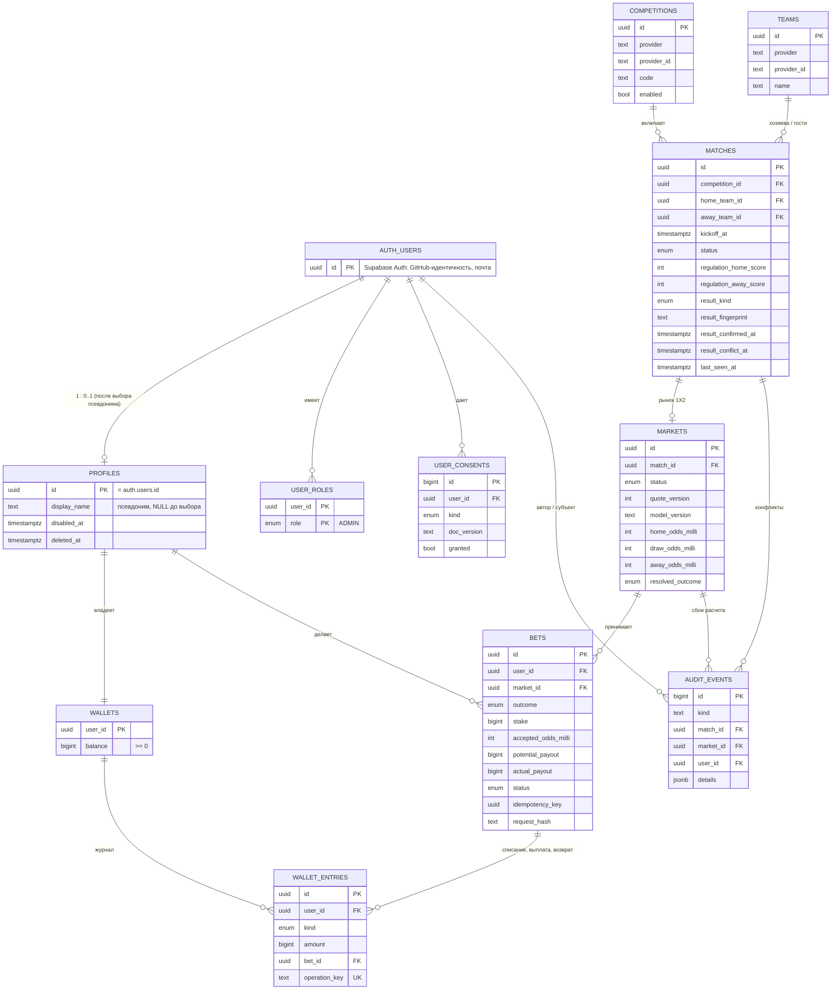
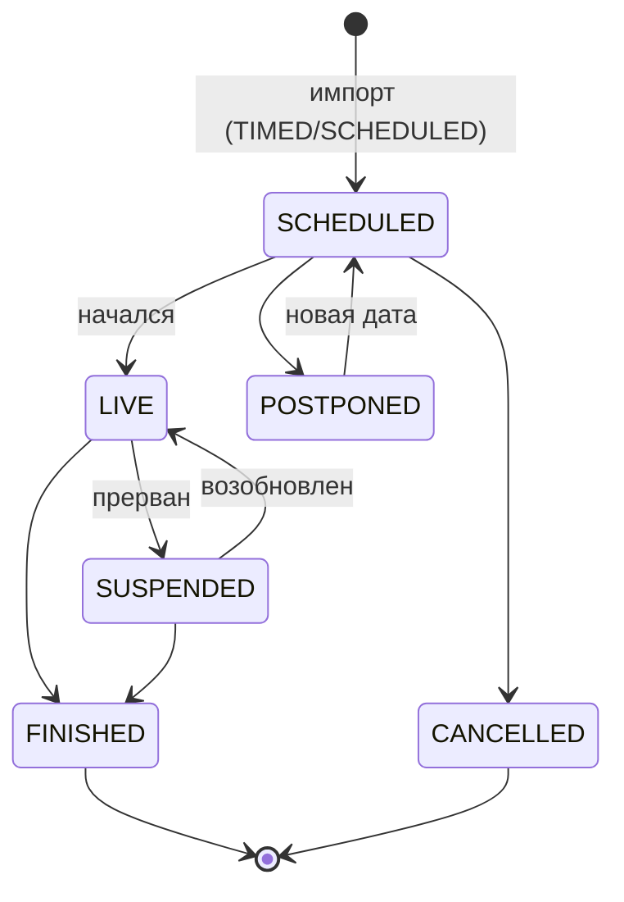
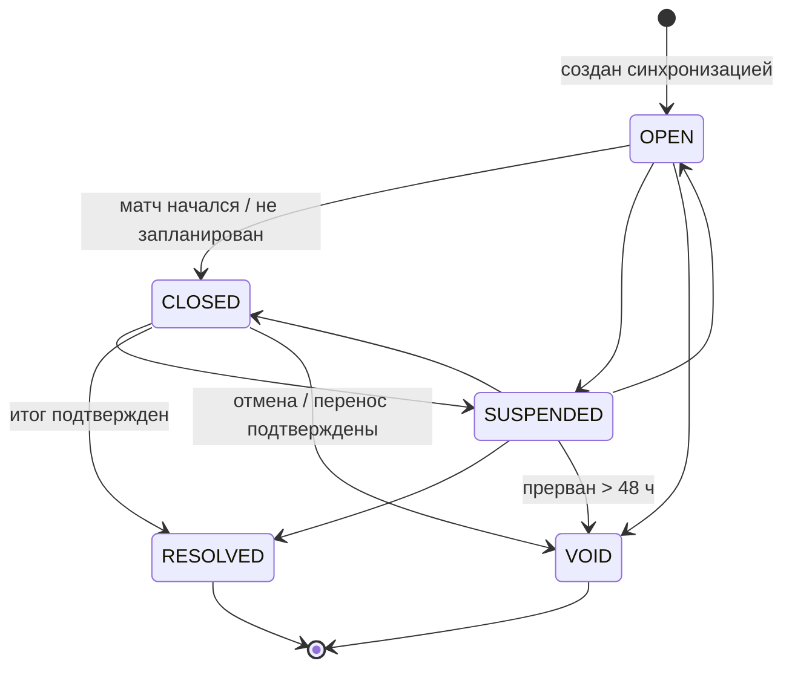
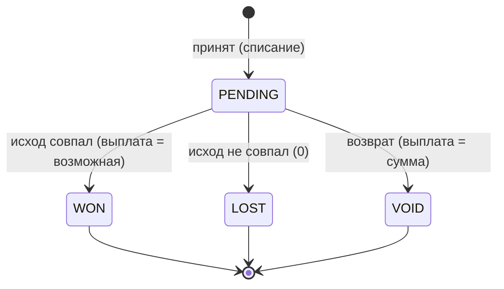
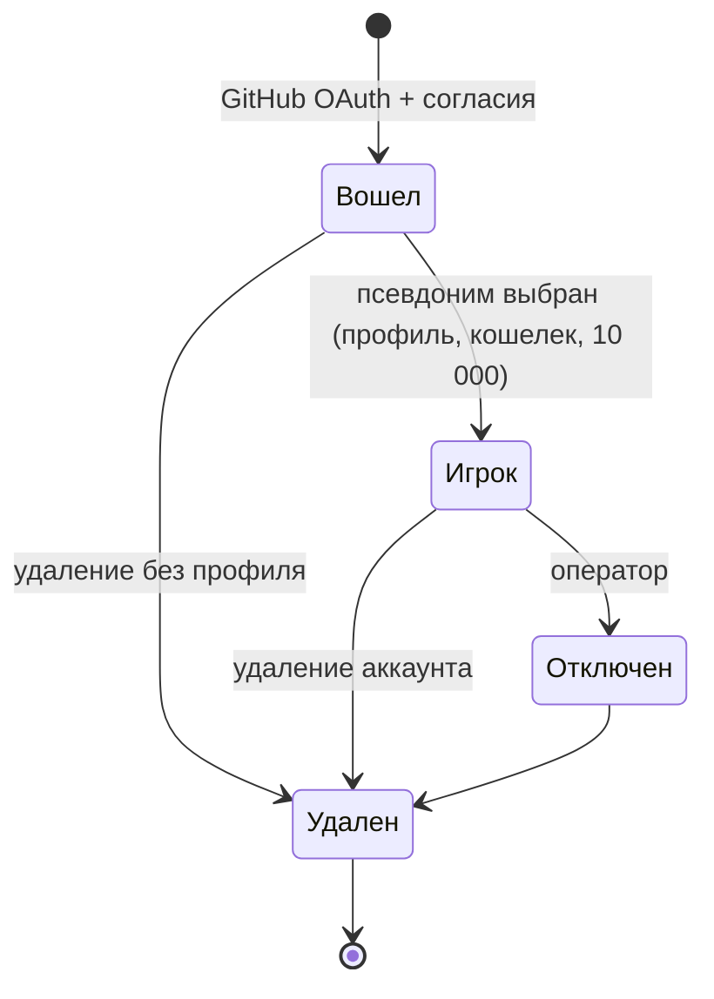

# 06. Модель данных и состояний

## Глоссарий

| Термин              | Значение                                                                                            |
| ------------------- | --------------------------------------------------------------------------------------------------- |
| Игрок               | пользователь, выбравший псевдоним; имеет профиль и кошелек                                          |
| Псевдоним           | публичное имя игрока; придумывается самим игроком один раз                                          |
| Монеты              | виртуальная единица учета без денежной стоимости                                                    |
| Матч                | футбольный матч от поставщика; время и статус — по данным поставщика                                |
| Рынок               | набор коэффициентов на матч; в MVP один тип — исход основного времени (1X2)                         |
| Исход               | `HOME` — победа хозяев (1), `DRAW` — ничья (X), `AWAY` — победа гостей (2)                          |
| Коэффициент «милли» | целое число в тысячных: `2350` = 2,35                                                               |
| Версия котировки    | номер набора коэффициентов рынка; меняется при пересчете                                            |
| Прогноз (ставка)    | выбор исхода и суммы игроком; после приема неизменяем                                               |
| Возможная выплата   | ⌊сумма × коэффициент / 1000⌋, включает сумму прогноза                                               |
| Журнал операций     | неизменяемые записи о движении монет; баланс — их сумма                                             |
| Ключ повтора        | UUID команды прогноза; повтор с тем же ключом не создает новый прогноз                              |
| Наблюдение итога    | факт получения от поставщика завершенного результата; два одинаковых через ≥ 10 мин — подтверждение |
| Отпечаток итога     | строка `FINISHED:h:a`, `CANCELLED` или `POSTPONED`, по которой сравниваются наблюдения              |
| Конфликт итога      | подтвержденный итог изменился после расчета рынка                                                   |
| Расчет              | перевод прогнозов рынка в `WON`, `LOST` или `VOID` с выплатами                                      |
| Аренда задания      | право одного исполнителя выполнять задание; у каждой выдачи свое поколение                          |
| Оператор ПДн        | владелец сайта, отвечающий за обработку персональных данных                                         |
| Устаревшие данные   | матч не обновлялся от поставщика больше 60 минут                                                    |

## ER-диаграмма

Служебные таблицы без связей: `job_leases` (аренда задания), `job_runs` (журнал запусков),
`provider_rate_limits` (бюджет запросов к поставщику), `rate_limit_buckets` (лимиты частоты по ключу).

## Словарь данных

### Пользователи и деньги

| Таблица.поле                   | Тип             | Ограничения и смысл                                                                                                            |
| ------------------------------ | --------------- | ------------------------------------------------------------------------------------------------------------------------------ |
| `profiles.id`                  | uuid PK         | = `auth.users.id`; профиль создается при выборе псевдонима                                                                     |
| `profiles.display_name`        | text            | NULL — не выбран (прежняя схема); 3–24 символа, без управляющих символов и `<>`; уникален без учета регистра среди неудаленных |
| `profiles.avatar_url`          | text            | всегда пуст (данные GitHub не копируются)                                                                                      |
| `profiles.disabled_at`         | timestamptz     | не NULL — аккаунт отключен: нет прогнозов, рейтинга, прав администратора                                                       |
| `profiles.deleted_at`          | timestamptz     | не NULL — удален самим пользователем; требует `disabled_at`                                                                    |
| `user_roles`                   | (user_id, role) | роль `ADMIN`; клиенты таблицу не читают и не пишут                                                                             |
| `wallets.balance`              | bigint          | ≥ 0; всегда равен сумме `wallet_entries.amount` пользователя                                                                   |
| `wallet_entries.kind`          | enum            | `INITIAL_CREDIT` (+, без прогноза, один раз), `STAKE_DEBIT` (−), `WIN_CREDIT` (+), `VOID_REFUND` (+), `ADMIN_ADJUSTMENT` (±)   |
| `wallet_entries.operation_key` | text UK         | детерминированный ключ операции (`win:<bet>`, `refund:<bet>`, `admin:<key>`) — защита от двойного начисления                   |
| `wallet_entries.bet_id`        | uuid FK         | обязателен для операций по прогнозу; одна запись списания и одна запись расчета на прогноз                                     |

### Матчи, рынки, прогнозы

| Таблица.поле                                         | Тип         | Ограничения и смысл                                                                    |
| ---------------------------------------------------- | ----------- | -------------------------------------------------------------------------------------- |
| `competitions.enabled`                               | bool        | показывается ли лига; MVP: PL, BL1, PD                                                 |
| `matches.(provider, provider_id)`                    | UK          | ключ поставщика; повторный импорт обновляет, а не дублирует                            |
| `matches.status`                                     | enum        | `SCHEDULED`, `LIVE`, `FINISHED`, `CANCELLED`, `POSTPONED`, `SUSPENDED`                 |
| `matches.regulation_*_score`                         | int         | счет основного времени; оба известны или оба NULL; ≥ 0                                 |
| `matches.result_kind`                                | enum        | `NONE` — итога нет, `REGULAR` — однозначный, `AMBIGUOUS` — не рассчитывать             |
| `matches.last_seen_at`                               | timestamptz | последнее получение от поставщика; > 60 мин назад — данные устарели                    |
| `matches.result_first_seen_at / result_confirmed_at` | timestamptz | первое наблюдение итога / подтверждение; подтверждение только после первого наблюдения |
| `matches.result_conflict_at`                         | timestamptz | итог изменился после расчета — автоматика по матчу на паузе                            |
| `markets.(match_id, type)`                           | UK          | один рынок типа на матч                                                                |
| `markets.*_odds_milli`                               | int         | 1100–12000                                                                             |
| `markets.quote_version`                              | int ≥ 1     | версия котировки; совпадение проверяется при приеме                                    |
| `markets.resolved_outcome / resolved_at`             | —           | заполнены ровно для `RESOLVED`; `resolved_at` — для `RESOLVED` и `VOID`                |
| `bets.(user_id, market_id)`                          | UK          | один прогноз на матч                                                                   |
| `bets.(user_id, idempotency_key)`                    | UK          | повтор команды                                                                         |
| `bets.stake`                                         | bigint      | 10–1000                                                                                |
| `bets.potential_payout`                              | bigint      | = ⌊stake × accepted_odds_milli / 1000⌋ (CHECK)                                         |
| `bets.status / actual_payout`                        | —           | `PENDING`: выплаты нет; `WON`: = possible; `LOST`: 0; `VOID`: = stake                  |
| `bets.request_hash`                                  | text        | отпечаток данных команды: тот же ключ с другими данными — `IDEMPOTENCY_CONFLICT`       |

### Согласия, аудит, служебные

| Таблица.поле                | Тип    | Смысл                                                                                                                                                        |
| --------------------------- | ------ | ------------------------------------------------------------------------------------------------------------------------------------------------------------ |
| `user_consents.kind`        | enum   | `TERMS_AND_AGE`, `PD_PROCESSING` (`PUBLICATION` — устаревшее значение, не пишется)                                                                           |
| `user_consents.doc_version` | text   | версия документов `YYYY-MM-DD`; журнал только дописывается                                                                                                   |
| `audit_events.kind`         | text   | `RESULT_CHANGED_AFTER_SETTLEMENT`, `RESULT_CONFLICT_ACKNOWLEDGED`, `ADMIN_CONFLICT_RESOLVED`, `ADMIN_SYNC_REQUESTED`, `SETTLEMENT_FAILED`, `ACCOUNT_DELETED` |
| `job_leases.generation`     | bigint | растет при каждой выдаче аренды; запись разрешена только текущему поколению                                                                                  |
| `job_runs.status`           | text   | `RUNNING`, `OK`, `PARTIAL`, `SKIPPED`, `FAILED`; хранится 30 дней                                                                                            |
| `provider_rate_limits`      | —      | окно и счетчик запросов к поставщику, `next_allowed_at` после 429                                                                                            |
| `rate_limit_buckets`        | —      | окна лимитов (`place_bet:<user>`, `pseudonym:<user>`, `admin:sync`); хранятся сутки                                                                          |

## Жизненные циклы

### Матч

### Рынок

Переходы проверяет триггер БД; `RESOLVED` и `VOID` терминальны.

### Прогноз

После приема меняются только `status`, `actual_payout`, `settled_at` и только из `PENDING`.

### Учетная запись

## Инварианты

1. `wallets.balance = Σ wallet_entries.amount` по пользователю — проверяется отложенным триггером при фиксации транзакции.
2. `wallets.balance ≥ 0`.
3. `wallet_entries` нельзя изменить или удалить; прогноз после приема изменяется только при расчете.
4. Одна запись списания и одна запись расчета на прогноз; один стартовый кредит на пользователя.
5. Состояние прогноза согласовано с выплатой и временем расчета (CHECK).
6. Подтверждение итога невозможно без первого наблюдения; счет — оба значения или ни одного.
7. Порядок блокировок во всех операциях: аренда → лимиты → рынки → матчи → прогнозы → кошельки (по `user_id`) — без взаимных блокировок.
