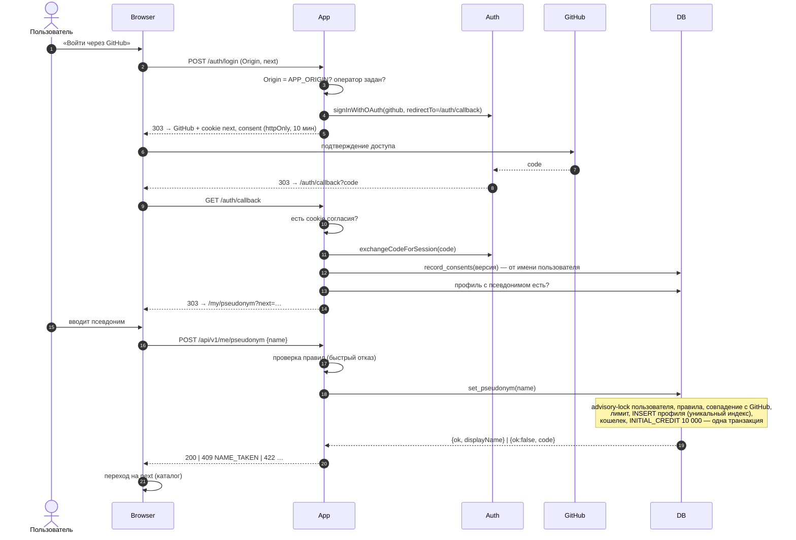
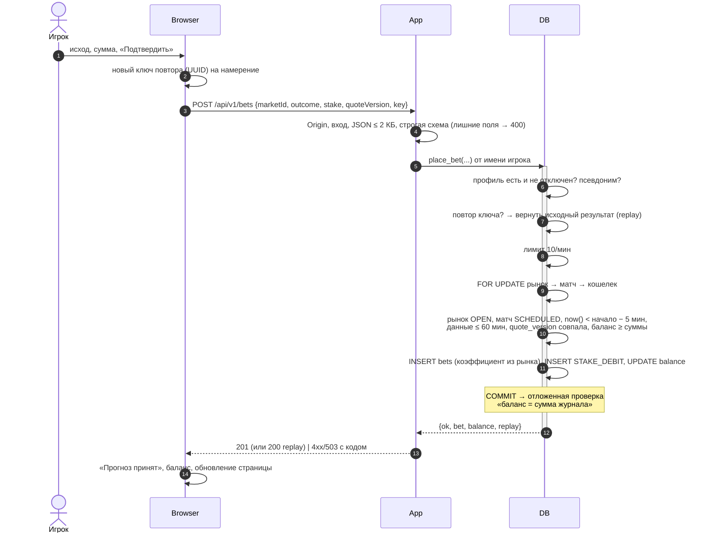
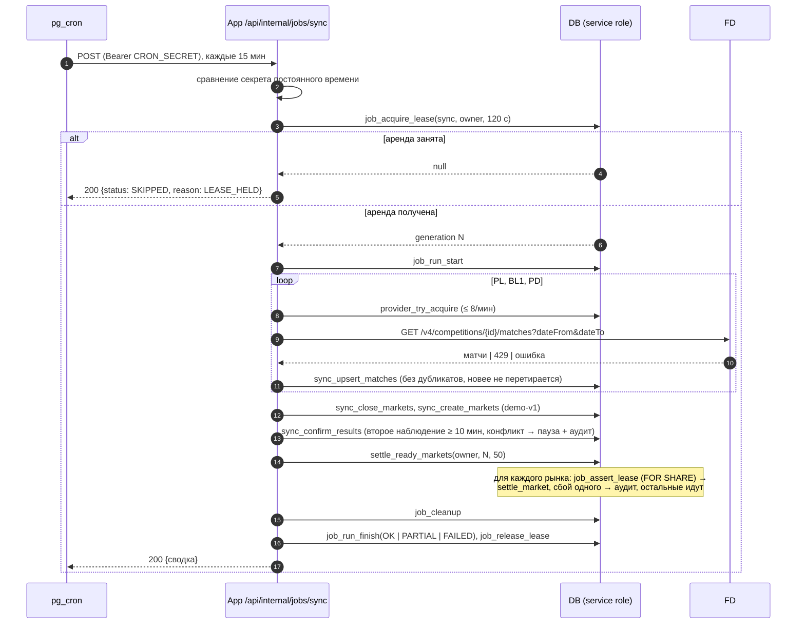
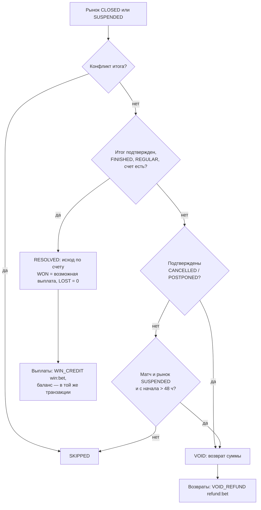
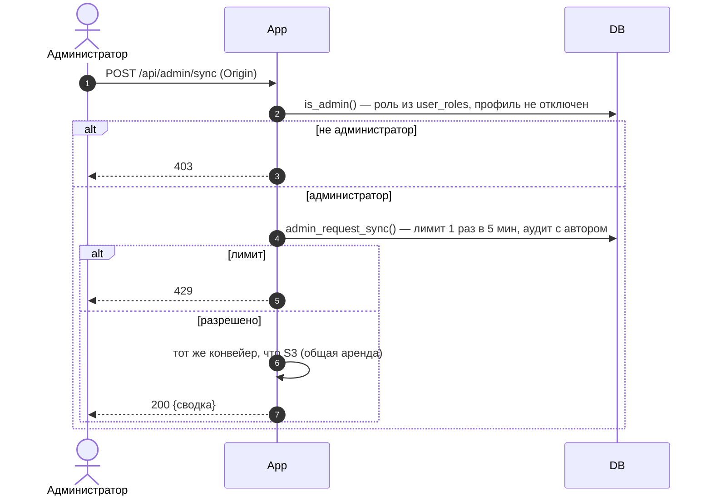
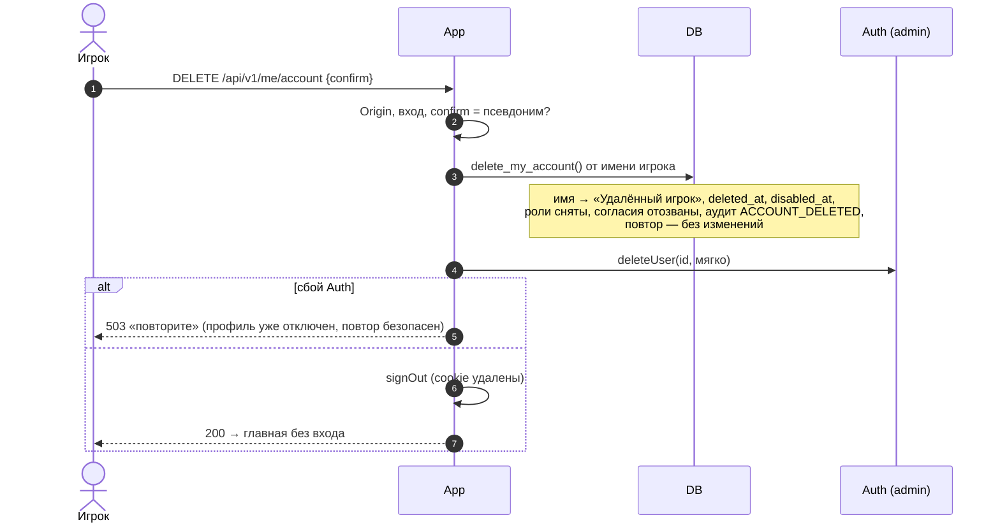

# 07. Поведенческие модели

Диаграммы последовательности для сценариев, где важен порядок шагов и место принятия решения.
Обозначения: **Browser** — браузер, **App** — Next.js (страницы, API, proxy), **DB** — PostgreSQL (функции и
RLS), **Auth** — Supabase Auth, **FD** — football-data.org.

## S1. Вход и выбор псевдонима (UC-01, UC-02)

## S2. Прогноз (UC-04)

Двойной клик: второй запрос с тем же ключом получает исходный прогноз (`replay`), второе списание невозможно —
уникальность `(user_id, idempotency_key)` и `(user_id, market_id)`.

## S3. Задание синхронизации и расчета (UC-07)

### Решение расчета одного рынка (`settle_market`)

## S4. Ручной запуск администратором (UC-09)

## S5. Удаление аккаунта (UC-10)

