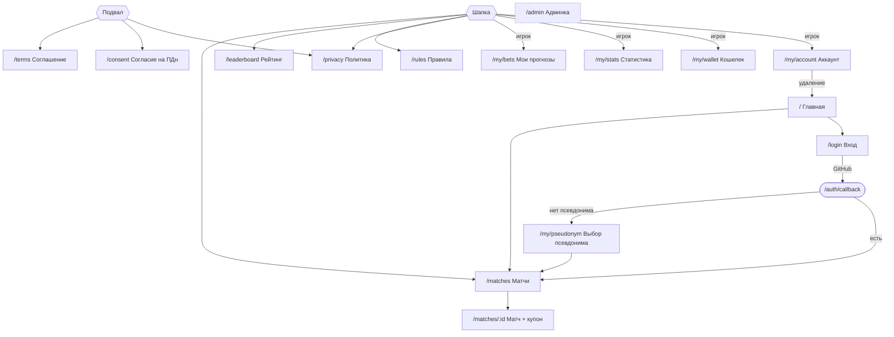

# 10. Экраны и навигация

## Карта экранов

Админка не связана ссылками: администратор открывает адрес вручную, остальным он отвечает 404.

## Общие элементы

- **Шапка:** логотип; «Матчи», «Рейтинг», «Правила», «Приватность»; у игрока — «Мои прогнозы», «Статистика»,
  «Кошелек», псевдоним (ссылка на «Аккаунт»), «Выйти»; у вошедшего без псевдонима — «Выбрать псевдоним» и
  «Выйти»; переключатель «День / Ночь».
- **Подвал:** дисклеймер (монеты без стоимости, коэффициенты демонстрационные, данные с задержкой), ссылки на
  документы, 18+, независимость от клубов и лиг, атрибуция football-data.org и автора фото.
- **Плашка «ДЕМО-РЕЖИМ»** — только в demo.
- **Фон:** фото с параллаксом и подложкой цвета темы; неподвижен при «уменьшить движение».
- **Доступность:** ссылка «Перейти к содержимому» первой по Tab, видимый фокус, подписи полей, ошибки
  связаны с полями, статусы текстом. Ширина от 360 px без горизонтальной прокрутки.
- **Состояния каждого экрана:** загрузка, пусто, ошибка (без технических деталей), устаревшие данные, нет доступа.

## Экраны

| Экран                                   | Маршрут                                    | Кто            | Назначение и элементы                                                                                                                                                              | Особые состояния                                                                                                        |
| --------------------------------------- | ------------------------------------------ | -------------- | ---------------------------------------------------------------------------------------------------------------------------------------------------------------------------------- | ----------------------------------------------------------------------------------------------------------------------- |
| Главная                                 | `/`                                        | все            | объяснение продукта, дисклеймер, «Посмотреть матчи», процесс в 3 шага                                                                                                              | —                                                                                                                       |
| Матчи                                   | `/matches`                                 | все            | фильтры (лига, период, дата, зона); карточки: лига, статус, команды, счет, время, коэффициенты 1/X/2, состояние приема; «Показать еще»                                             | нет матчей → «Сбросить фильтры»; устаревшие данные → предупреждение на карточке                                         |
| Матч                                    | `/matches/:id`                             | все            | карточка матча, правила приема; купон: исход, сумма (ползунок и поле 10–1000), возможная выплата, «Подтвердить прогноз»                                                            | гость → «Войдите»; без псевдонима → «выберите псевдоним»; прием закрыт → причина; прогноз уже есть → его параметры; 404 |
| Рейтинг                                 | `/leaderboard`                             | все            | таблица: место, псевдоним, прогнозов, угадано %, ROI, результат; правила допуска; у вошедшего — свое место или сколько осталось                                                    | никто не допущен → пустое состояние; demo → вымышленные игроки с пометкой                                               |
| Вход                                    | `/login`                                   | гость          | кнопка «Войти через GitHub», подпись о согласии со ссылками                                                                                                                        | оператор не задан → вход закрыт с причиной; ошибки: отменено, нужно согласие, аккаунт отключен                          |
| Выбор псевдонима                        | `/my/pseudonym`                            | без псевдонима | объяснение (публичность, не настоящее имя, выбор один раз), поле с правилами, «Выбрать псевдоним»                                                                                  | ошибки валидации у поля; имя занято; лимит                                                                              |
| Мои прогнозы                            | `/my/bets`                                 | игрок          | фильтр по статусу; список: матч, исход, сумма, коэффициент, статус текстом, выплата; пагинация                                                                                     | пусто → «Выбрать матч»                                                                                                  |
| Статистика                              | `/my/stats`                                | игрок          | 9 показателей, место в рейтинге или «осталось N», формулы                                                                                                                          | нет прогнозов → «—» и подсказка                                                                                         |
| Кошелек                                 | `/my/wallet`                               | игрок          | баланс, журнал: вид операции, дата, сумма со знаком                                                                                                                                | ошибка чтения → баланс не показывается                                                                                  |
| Аккаунт                                 | `/my/account`                              | вошедший       | псевдоним, согласия, удаление аккаунта с подтверждением                                                                                                                            | без псевдонима — подтверждение словом «удалить»                                                                         |
| Правила, Политика, Соглашение, Согласие | `/rules`, `/privacy`, `/terms`, `/consent` | все            | тексты; данные оператора; редакция документов                                                                                                                                      | оператор не задан → «не указано»                                                                                        |
| Админка                                 | `/admin`                                   | админ          | режим и поставщик; «Запустить синхронизацию»; состояние задания (6 показателей); очередь расчета с причиной и ожидаемым временем, «Принять итог» для конфликтов; последние запуски | не админ → 404; ошибка → сообщение                                                                                      |
| Не найдено                              | любой                                      | все            | «Страница не найдена», ссылка на главную                                                                                                                                           | —                                                                                                                       |

## Тексты ошибок купона

| Код                    | Текст для игрока                                                        |
| ---------------------- | ----------------------------------------------------------------------- |
| `INSUFFICIENT_BALANCE` | Недостаточно монет                                                      |
| `QUOTE_CHANGED`        | Коэффициенты изменились. Проверьте и подтвердите снова                  |
| `MARKET_CLOSED`        | Прием прогнозов на этот матч закрыт                                     |
| `DATA_STALE`           | Данные матча устарели, прием временно закрыт                            |
| `ALREADY_PLACED`       | Прогноз на этот матч уже сделан                                         |
| `RATE_LIMITED`         | Слишком много попыток. Подождите минуту                                 |
| `PSEUDONYM_REQUIRED`   | Сначала выберите псевдоним: без него прогнозы не принимаются            |
| сеть недоступна        | Нет ответа от сервера. Нажмите «Подтвердить» еще раз — повтор безопасен |
